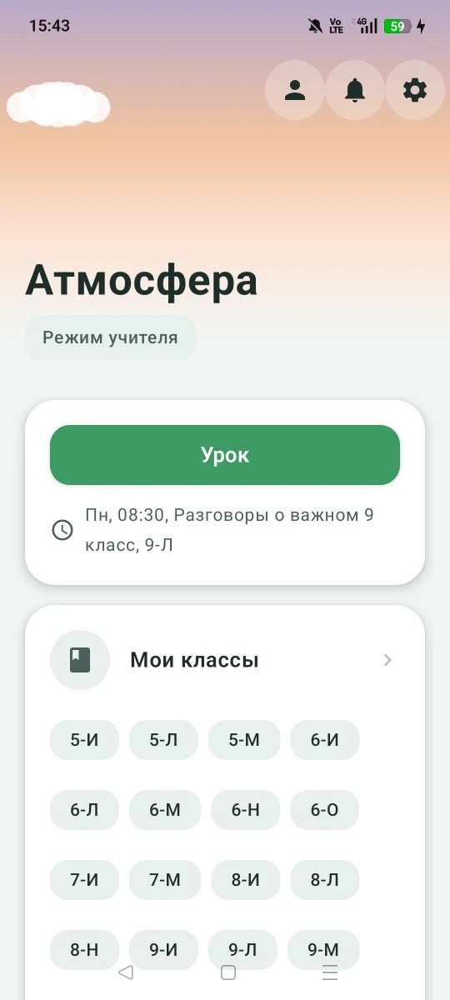
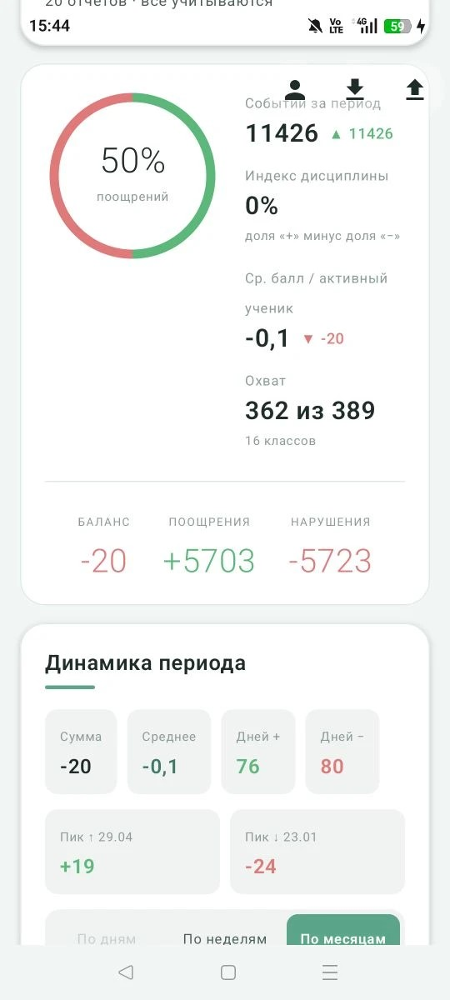
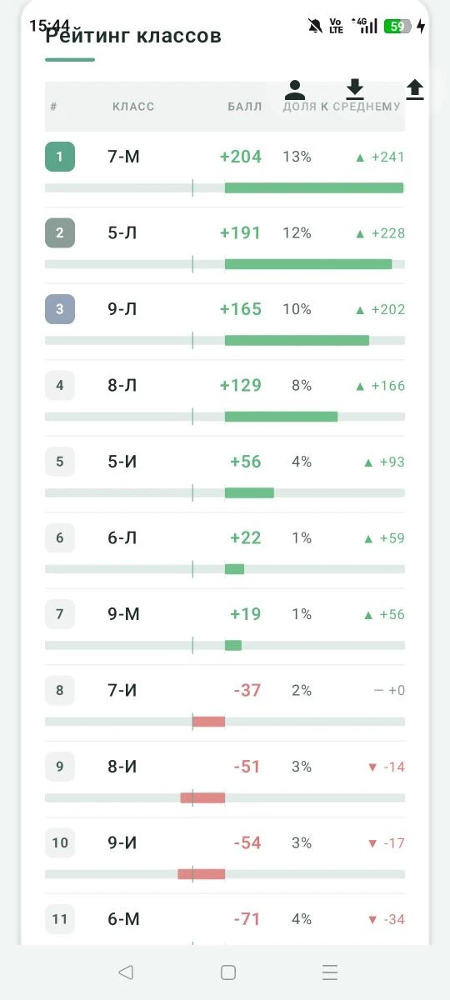
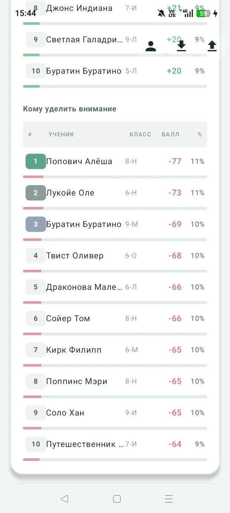
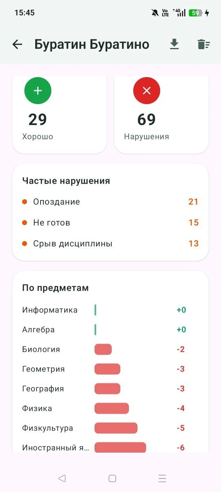
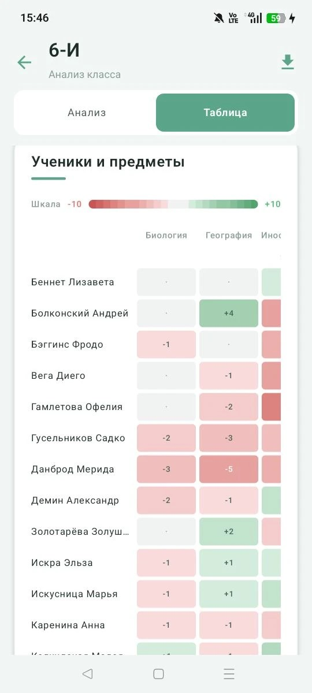
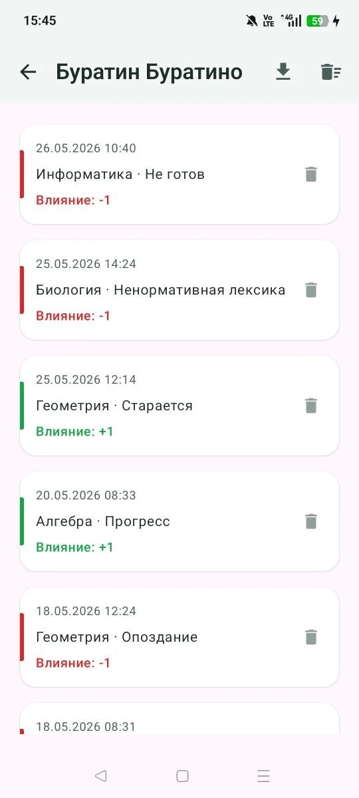

# Атмосфера

Журнал поведения для школы на Android. Учитель на уроке одним касанием отмечает, кто старался, а кто мешал. Завуч собирает отчёты учителей и видит картину по всей школе: какие классы справляются, где проблемы, кого стоит похвалить.

Без интернета, без облака и без регистрации. Все данные хранятся в телефоне.

  
  
  
  
   
  
  
  

## Зачем

Бумажный журнал замечаний ведут от случая к случаю, а к педсовету завуч собирает сведения по кусочкам. «Атмосфера» делает обе части простыми: учителю — несколько секунд на уроке, завучу — готовая сводка вместо опроса коллег.

## Учителю

- Ученики и расписание загружаются из «Моей школы» в пару касаний. Можно и вручную или через шаблон Excel.
- Во время урока приложение само знает, какой сейчас урок. Нажимаете «Урок», касаетесь ученика, выбираете отметку: «старается», «помогает классу», «опоздал», «гаджет на уроке» и другие.
- У каждого ученика есть профиль: история отметок, частые нарушения, разбивка по предметам. Пригодится перед разговором с родителями.
- Есть напоминания о родительских собраниях и, по желанию, об уроках, на которых вы забыли поставить отметки.
- Летом классы переводятся на год вперёд одной кнопкой, выпускники уходят в архив. Загружать всё заново не нужно.
- Раз в неделю или в месяц вы отправляете завучу отчёт: по школьному Wi-Fi напрямую на его телефон или файлом через мессенджер.

## Завучу

- Отчёты всех учителей складываются в одну сводку. Один и тот же ученик у разных учителей узнаётся по классу и ФИО, его отметки по всем предметам собираются вместе.
- Сводка за неделю, месяц или любой период: динамика, рейтинг классов, сравнение параллелей, тепловая карта «класс × день недели».
- Готовые списки «кого поощрить» и «кому уделить внимание» и тезисы для педсовета.
- Разбор отдельного класса и поиск ученика по фамилии.
- Отчёты по школе, классу или ученику выгружаются в PDF для печати или в HTML.
- Любой отчёт учителя можно временно исключить из сводки, не удаляя его.

## Данные

ФИО учеников и отметки хранятся только на телефоне учителя и, если он отправил отчёт, на телефоне завуча. Разработчику ничего не передаётся, серверов у приложения нет.

Файл отчёта сохраняется в собственном формате `.atmo`, который обычные программы не открывают. Это не полноценное шифрование, поэтому отправляйте отчёт только завучу. Подробности — в [политике конфиденциальности](docs/PRIVACY_POLICY.md).

Резервного копирования в облако нет: если телефон потеряется, данные пропадут вместе с ним.

## Как пользоваться

Подробная инструкция для учителя и завуча: [docs/USER_GUIDE.md](docs/USER_GUIDE.md). Та же справка есть в самом приложении: Настройки → «Как пользоваться приложением».

## Требования

Android 8.0 и новее. Для передачи отчётов по Wi-Fi телефоны учителя и завуча должны быть в одной сети.

## Сборка

Проект на Kotlin и Jetpack Compose (Room, Hilt, Ktor для передачи по локальной сети, Apache POI для Excel).

1. Откройте папку проекта в Android Studio. Нужен JDK 17.
2. Соберите отладочную версию: `./gradlew assembleDebug`.

Ключи подписи релиза в репозиторий не входят.

## Лицензия

Исходный код распространяется под [GNU GPL v3](LICENSE). Если GPL вам не подходит, например для закрытой доработки, есть [коммерческая лицензия](COMMERCIAL_LICENSE.md).

## Автор

Сергей Каманов — mr.kamanov@yandex.ru. Вопросы, ошибки и предложения можно присылать на почту или в [Issues](https://github.com/mrKamanov/atmosphere/issues).
